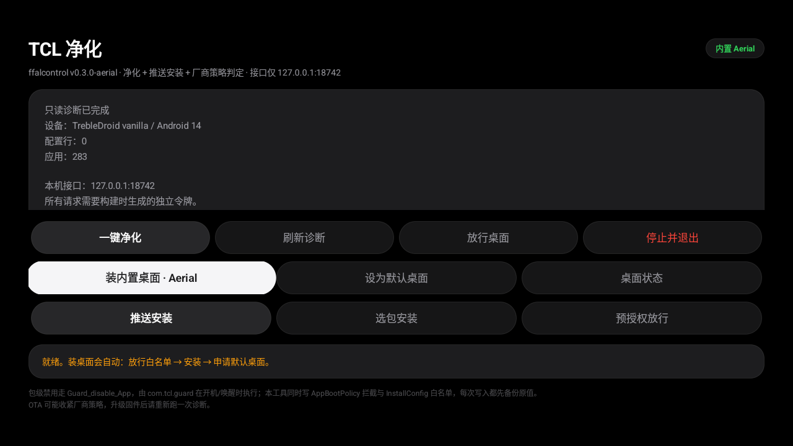
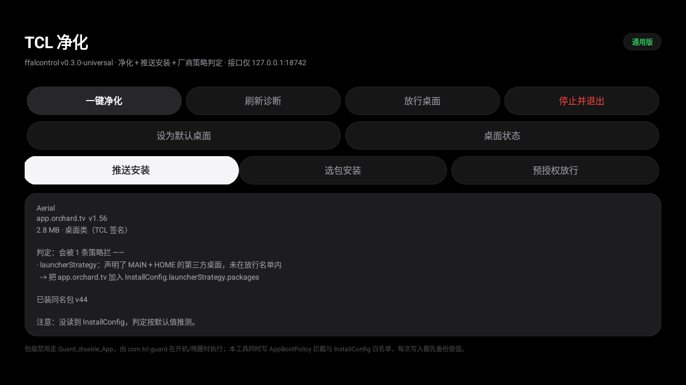

# TCL 电视净化 · 内置桌面单包装

给 **TCL / 雷鸟（FFALCON）Android TV** 用的一个 APK：关掉预装广告与推荐位、装好第三方桌面并设为首页、把那些被厂商拦下来的包装进去。

不用电脑、不用 ADB、不用 root。桌面已经打进包里，断网也能用。

## 📄 图文介绍页（先看这个）

### 👉 https://mmaotv.github.io/ffalcontrol-tcl/

那页有截图、兼容性表和四个包的直连下载，比 README 好读。GitHub Pages 偶尔抽风打不开就走 [Releases](../../releases)。

<p align="center">
  
  
</p>

<p align="center"><sub>实机截图：左 = 主界面（一块面板，遥控器走完）；右 = 装包前先告诉你会被哪条厂商策略拦</sub></p>

## 它解决什么

| 你遇到的 | 真正的原因 | 这个工具做的 |
|---|---|---|
| 第三方桌面装不上 | 安装器拦所有声明了 `MAIN`+`HOME` 的包 | 只把这个桌面包名加进放行名单 |
| U 盘 / 文件管理器点装被拒 | 来源校验只在「系统安装器发起」时生效 | 改走自己的安装会话，天然不触发 |
| 开机就是广告和推荐位 | 厂商有自己的开关，不在设置里 | 写 `Guard_disable_App`，包级禁用 22 个包 |
| 网上说「开 ADB 装」也不管用 | `pmStrategy` 专拦带 `INSTALL_FROM_ADB` 的安装 | 同上，不走 adb |

一句话：**不关闭任何全局校验，只改真正需要的那一条。**

## 下载：四个包，只装一个

签名相同、包名相同，可以互相覆盖安装，换桌面不用先卸载。

| 变体 | 内置桌面 | 体积 | 适合谁 |
|---|---|---|---|
| **universal** · [下载](https://github.com/mmaotv/ffalcontrol-tcl/releases/download/v0.3.0/ffalcontrol-0.3.0-universal.apk) | 无 | ~90 KB | **已经装好桌面的人**，只要净化和放行 |
| **cleanyourtv** · [下载](https://github.com/mmaotv/ffalcontrol-tcl/releases/download/v0.3.0/ffalcontrol-0.3.0-cleanyourtv.apk) | CleanYourTV 3.0.0 | ~0.6 MB | 想要极简、无推荐位的桌面 |
| **aerial** · [下载](https://github.com/mmaotv/ffalcontrol-tcl/releases/download/v0.3.0/ffalcontrol-0.3.0-aerial.apk) | Aerial 1.56 | ~3 MB | tvOS 风格，推荐首选 |
| **emotnui** · [下载](https://github.com/mmaotv/ffalcontrol-tcl/releases/download/v0.3.0/ffalcontrol-0.3.0-emotnui.apk) | Emotn UI 1.1.0.2 | ~14 MB | 影视海报墙风格 |

直连下载（国内更快）：[介绍页](https://mmaotv.github.io/ffalcontrol-tcl/#download) 四个按钮各自对应一个包。

## 三步用起来

1. **装上去** —— APK 拷 U 盘插电视，用电视上的文件管理器点开装；首次会问「允许安装未知应用」。
2. **点一个按钮** —— 打开应用，点「装内置桌面 · XXX」，它会依次做完：写安装白名单 → 从包内流式安装桌面 → 申请默认桌面。
3. **拔插头 30 秒再上电** —— 包级禁用由 `com.tcl.guard` 在开机时执行，不冷启动不生效。

开机后如果厂商桌面抢了一次前台，按一下 **Home** 键就回到新桌面（固件在 `systemReady` 时硬编码拉起一次 `com.tcl.cyberui`，改不了）。

**还要装别的 APK？** 点「推送安装」，屏幕会显示 `http://<电视IP>:18743`，手机连同一个 WiFi 打开它上传就行，不用 U 盘、不用第二台设备。这个页面只能收文件，装不装仍由电视前的人点。

## 支持哪些电视

**✅ 确认可用**：TCL Smart TV Pro（`MT9655_4K_CN`，Android 14，固件 `UTT2.250416.001`）

**🟡 大概率可用**（同一套固件体系，未逐个验证）：

- MT9655 / MT9653 平台的 TCL 电视，Android 12–14 国内版
- 雷鸟 FFALCON 同代机型（样板机是 鹤7 75R79A）
- TCL 集团旗下用同一套 CyberUI / TGuard 固件的品牌

**⛔ 不要装**：非 MT96 平台的旧 TCL（Amlogic / 海思方案）、海外版 Google TV 固件、其它品牌（小米 / 海信 / 华为）——机制完全不同。

装之前可以先自查，在电视的终端（或任意一台能跑 shell 的设备上 `adb shell`）执行：

```sh
getprop ro.board.platform      # 应为 MT9655 / MT9653
pm path com.tcl.guard          # 应有输出
```

两条都满足才装。

## 它改了什么

全部走厂商自己暴露的配置通道，不 hook、不刷机、不碰系统分区。

| 配置行 | 谁消费 | 效果 |
|---|---|---|
| `Guard_disable_App` | `com.tcl.guard`（开机 / 唤醒） | 包级禁用，等价 `pm disable-user`，重启保持 |
| `AppBootPolicy.activityBlackList` | TCL 框架 | 拦掉应用商店、桌面切换等入口 |
| `InstallConfig` 的三个名单 | `PackageInstaller_tv` | 桌面放行名单 / 两个拦截名单 |

每次写之前读原值、算 SHA-256、带 `expected_sha256` 做 compare-and-set，写完读回核对，不一致就失败、不盲写。改动前的原始内容留在 `/backups`，装失败会自动回滚。

**只允许从黑名单里移除，绝不往里加。** 也**不会**关掉 `InstallConfig` 顶层开关（那等于六个策略全废）。

## 风险

- 它真的在写系统配置。写错会让你点不开某些应用，最坏情况要恢复出厂。
- 恢复出厂不会回滚固件版本；OTA 升级后策略可能收紧，升完请重新跑一次「刷新诊断」。
- 预装应用在只读分区，厂商卸载白名单为空，**能禁用不能真删**。
- 装任何包仍会弹**一次**系统安装确认框。普通应用没有静默安装权限，这一步免不了，也故意不免。

## 更多

| 想看什么 | 去哪 |
|---|---|
| 六个安装策略到底怎么判、判定流程图 | [docs/technical.md](docs/technical.md) |
| 本机 HTTP 接口（想用脚本驱动它） | [docs/technical.md#本机接口](docs/technical.md#本机接口) |
| 自己编译 / 自测 / 换一套内置桌面 | [docs/build.md](docs/build.md) |
| 与上游 `xnklerEd/ffalcontrol` 的差异 | [docs/technical.md#与上游的差异](docs/technical.md#与上游的差异) |
| 内嵌桌面的版权与许可 | [NOTICE.md](NOTICE.md) |

## 来源

本项目是 [xnklerEd/ffalcontrol](https://github.com/xnklerEd/ffalcontrol)（MIT）的衍生版：上游提供了 ConfigProvider 读写与配置写入校验的主体，本仓库在其上增加了内置桌面、HOME 角色申请、界面、策略判定与推送安装。

非官方项目，与 TCL、雷鸟、FFALCON 无关。

## 免责声明

只在**你自己的设备**上使用；因使用本工具导致的任何后果由使用者自行承担。

本工具做的是**绕过厂商对安装来源的额外限制**，不是绕过 Android 的安装确认，也不是绕过任何内容版权 / 会员校验——后者不做，也没打算做。
